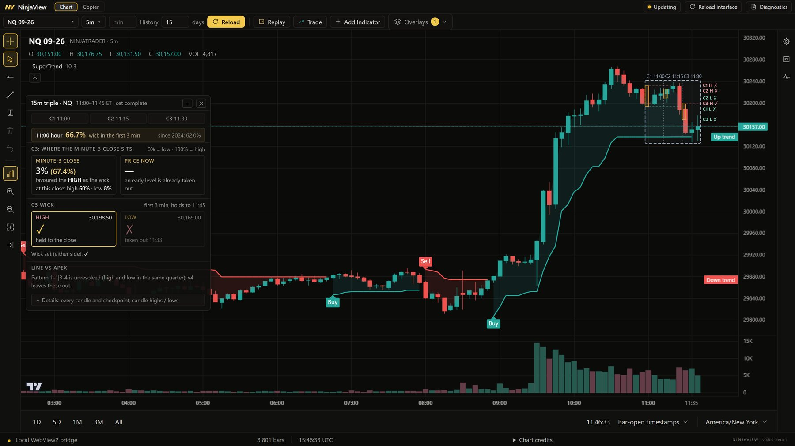

# NinjaView: a modern, TradingView-style chart for NinjaTrader 8

**A chart window that runs inside NinjaTrader 8, on your NinjaTrader data and accounts: trade from the chart, replay the market, copy trades across accounts, and run TradingView Pine Script and NinjaTrader indicators side by side.**

Open **New > NinjaView** in NinjaTrader. The window uses NinjaTrader's market data, your NinjaTrader accounts and NinjaTrader's order routing, so it fits alongside the platform you already use:

- **Chart trading:** market, limit and stop orders, a stop loss with one or more partial take profits you drag on the chart, draft orders, and every position on the account with Flatten per instrument.
- **Bar Replay and paper trading:** play the market forward from any bar with your indicators, and trade it with a TradingView-style order panel.
- **Copier and Groups:** copy every order from one account to others you select.
- **Indicators:** up to 16 at once, your TradingView Pine scripts and your NinjaTrader indicators, in a TradingView-style legend.
- **Overlays:** the 15m triple for NQ and ES; PackView for Pack members in the Pack edition.
- **Black & Gold or Slate** interface themes and TradingView-style chart settings.

Pine scripts also run on regular NinjaTrader charts through the **NinjaView Pine** indicator, with no conversion to NinjaScript.

**[Download the latest release](https://github.com/nejjie73/NinjaView/releases/latest)** · [Install guide](docs/install.md) · [What's supported](docs/supported-features.md) · [Report an issue](https://github.com/nejjie73/NinjaView/issues/new/choose)

## In detail

- Pine v5 and v6: persistent `var`/`varip` state with correct realtime rollback, user types, methods, enums, arrays, maps, matrices, named arguments, tuples, switch/if/for/while, and most `ta.*`, `math.*`, `str.*` and drawing functions.
- Older Pine v1–v4 scripts (many classic public indicators) are upgraded automatically.
- Every plot style (line, step, histogram, columns, area, circles, cross), linefills, and higher-timeframe `request.security`.
- Separate-panel (oscillator) scripts get their own panel; `force_overlay` objects draw on the price chart.
- Script inputs appear in NinjaTrader's indicator settings and are saved with your workspace.
- Public libraries (`import Owner/Library/Version`) are fetched once from TradingView by exact version, verified and cached. Local copies always take priority.
- **Several indicators on one chart:** the NinjaView window holds up to 16 indicators at once, Pine and NinjaTrader mixed, in a TradingView-style legend with hide/show, settings and remove. They stay on the chart when you reopen the window, and changing one never recalculates the others.
- **Your NinjaTrader indicators in the NinjaView window** (experimental): Add Indicator lists every installed NinjaTrader indicator next to your Pine scripts. They run on NinjaTrader's own engine with their plots, drawings and on-chart painting, and their settings are editable in NinjaView.
- **Bar Replay and paper trading** in the NinjaView window: start from any bar (or a random one), play the market forward with your Pine indicator, and trade it with a TradingView-style order panel, quick buy/sell buttons and a right-click menu. Results show P&L, win rate, profit factor and drawdown; trade logs save as CSV. Fills are simulated on one-minute bars.
- **Copy trades between your accounts** (new, lightly tested): the Copier tab copies every order you place on one NinjaTrader account to the others you select, at the same size, on your PC with no outside service. Save sets of accounts as Groups and swap them from the account list. It stops with an alert if anything looks wrong. Check your prop firm's rules on copying first.
- **The 15m triple** (new, in the NinjaView window's Overlays menu): boxes each hour's three 15-minute candles on NQ and ES and their first 3 minutes, with the odds that the early high or low holds as the wick. A cog on each overlay switches any drawing on or off.
- **PackView, for Pack members:** the Pack edition adds PackView, the Pack's read on price for NQ, ES, GC and RTY, live and in Bar Replay: the Asia, London, NY1 and NY2 ranges with true / false and their MFE ladders, P12, the prior day's levels with their Candle Science odds, the 9am hour, the four-step checklists and the three-hour Line / Apex block with Mick's workbook numbers.
- **Black & Gold:** a second interface theme, in Chart settings > Canvas > Interface theme.
- **Trading from the NinjaView window:** trade the chart on a NinjaTrader account you choose, with market, limit and stop orders, a stop loss and one or more take profits you drag on the chart (split the exit into partial take profits, each with its share of the stop), draft orders you can position before sending, working orders you can resize, Flatten and Reverse. The positions panel lists every instrument on the account, grouped by instrument, with Flatten per instrument or Flatten all. List of trades and Performance show how the account has traded across its whole NinjaTrader history: P&L, win rate, profit factor, drawdown and an equity curve. Orders go through NinjaTrader like Chart Trader; trading starts switched off in every window and live accounts are labelled LIVE. Trading involves substantial risk of loss: try a simulation account first.
- No TradingView login, and NinjaView never sees your broker login.

## Requirements

- NinjaTrader 8 (tested on 8.1.9.0), Windows x64
- Time-based minute charts (tick, range, Renko and daily charts are not supported yet)

## Limits

NinjaView is an independent, partial implementation of Pine. Some scripts will not compile yet, `strategy()` scripts show their plots and drawings without backtesting their orders, replay trading is simulated on one-minute bars, and a script that loads may still calculate differently from TradingView. Check results against TradingView before relying on them. See [what's supported](docs/supported-features.md) for details.

If a script fails, [open an issue](https://github.com/nejjie73/NinjaView/issues/new/choose) with the error message and a link to the public script.

## License key

To enter a license key, use **Control Center > New > NinjaView** or the NinjaView Pine indicator's **License key** setting.

No warranty; not financial advice. Not affiliated with TradingView or NinjaTrader. See [TERMS.md](TERMS.md).
